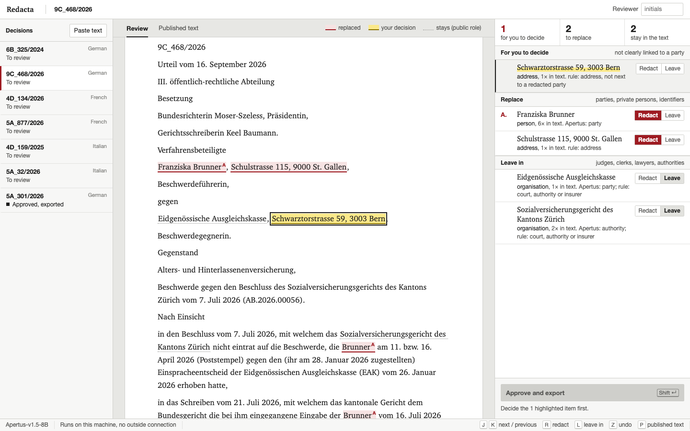
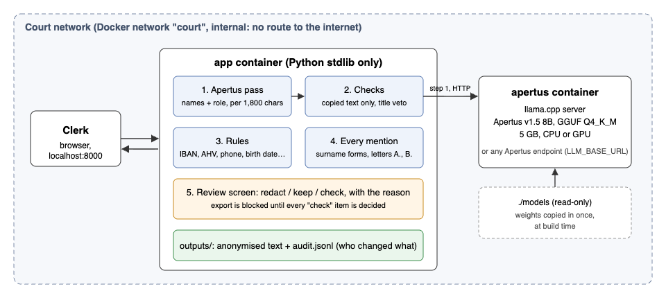

# Redacta — anonymising Swiss court decisions with Apertus, offline

Before a Swiss court publishes a decision, a clerk replaces the parties' names with `A.________`, `B.________` and removes addresses and dates of birth. Redacta does the first pass: **Apertus v1.5 8B** and a set of rules mark what to remove, and the clerk approves or changes each mark. Everything runs on the court's own machine, with no internet connection.



**Measured on 144 test decisions of the Federal Supreme Court (German, French, Italian)** with synthetic names put back where the court's placeholders were:

| | Redacta | Off-the-shelf NER (baseline only) | Rules only |
|---|---|---|---|
| Strings that must go, found by default | **96.1%** | 72.6% | 14.0% |
| Judge, clerk and lawyer names wrongly removed | **1.4%** | 59.0% | 0.0% |
| Decisions with nothing missed | 77.8% | 9.7% | 0.0% |
| Items for the clerk to confirm per decision | 3.9 | 15.5 | — |

The NER baseline is spaCy `xx_ent_wiki_sm` with every person and organisation redacted; it is used only for this comparison, not in Redacta. Speed on the same ten test decisions: 26.6 s per decision with Apertus on a laptop GPU (Metal), 109.5 s in the CPU-only container.

Details, method and limitations: [technical report](technical_report.md) ([PDF](Redacta_Report.pdf)). Demo video: (link in the submission form)

## Run it

Two ways, both with `make run` from this directory. Then open http://localhost:8000.

**1. Air-gapped (default).** Apertus runs in a llama.cpp container on a Docker network with no route to the internet. Needs the 5 GB weights in `./models` once:

```bash
make model               # build time, needs internet once: downloads models/apertus-v1.5-8b-text-q4_k_m.gguf
make run                 # from here on no network is needed
```

If the weights are missing and no endpoint is set, `make run` runs `make model` itself and then starts.
Clone into your home directory: Colima and Docker Desktop may not share paths outside it (such as `/tmp`) with containers, and the model container then finds no weights.
Without a GPU (Apertus on CPU inside Docker), the first analysis of the six sample decisions takes about 7 minutes; the page is up before that and fills in as each decision is done.

**2. Existing Apertus endpoint** (e.g. a sovereign Swiss cloud or an in-house server):

```bash
export LLM_BASE_URL=https://.../v1  LLM_NAME=swiss-ai/Apertus-v1.5-8B  LLM_API_KEY=...
make run                 # starts only the review app
```

On start the app analyses the six sample decisions in `data/sample/` (two per language). *+ Paste a decision* analyses any other text. *Approve and export* downloads the anonymised text and appends to `outputs/audit.jsonl`.

Measure accuracy yourself: `make eval-all` (rules only, Apertus only, Redacta), results in `outputs/eval_*/metrics.json`. Our results are in `docs/results/`.

## How it works

1. Apertus reads the decision in chunks of about 1,800 characters, with the list of parties as context, and returns every name with its role (party, private person, judge, lawyer, authority, ...).
2. A name is used only if Apertus copied it exactly from the text. Roles are voted over all mentions.
3. Rules catch IBAN, AHV number, phone, licence plate, date of birth and street addresses, and keep any name that follows a judge, clerk or lawyer title or sits in the bench list.
4. Each person gets a letter in order of appearance; surname-only mentions and relatives with the same surname are covered.
5. The review screen shows the decision as a page with every proposal marked, and beside it three lists: *for you to decide*, *redact* and *keep*, with the reason for each. Keys: `↓`/`↑` next and previous item, `R` redact, `K` keep, `Z` undo, `P` published text, `Shift+Enter` approve. Export is blocked until every *for you to decide* item has a decision.



## Layout

| Path | What it is |
|---|---|
| `src/anonymizer/` | pipeline, rules, Apertus client and prompt |
| `src/app.py`, `src/static/` | review server and page (Python standard library only) |
| `src/fetch_decisions.py`, `src/build_benchmark.py`, `src/evaluate.py` | data download, refilled benchmark, scoring |
| `data/raw/` | 180 published decisions (already anonymised by the court) |
| `data/benchmark/` | refilled benchmark with exact answer offsets |
| `data/sample/` | six refilled decisions shown on start |
| `scripts/` | model download, and how the text-only GGUF was built |
| `docs/` | report figures, results, the original challenge description |

## License

Code Apache-2.0, documentation CC-BY-4.0, data CDLA-Permissive-2.0. Built for [Hack Apertus](https://hackapertus.ch) 2026, Track 2B.

---

## Challenge description (from the Hack Apertus template)

Bring your own idea and build a working Apertus prototype that tackles a problem you care about — any domain, any use case. The project must be new, started within the hackathon period.

Submissions must use the Apertus model family.
For Track 2 this means that submitted solutions must be built with Apertus. Other open-weights models can be used to support development, e.g. as automatic judges during evaluation. Their role must be clearly described in the submission report.

💬 In case you have questions, join the conversation on [Discord](https://discord.gg/hack-apertus) or send an email to “hello@hackapertus.ch”

---

## 🔧 Resources & Tools

Check our resources & tools page for detailed information:
https://hackapertus.notion.site/resources-tools

| Models           | URL                                      |
|------------------|------------------------------------------|
| Apertus v1.5 8B  | [huggingface.co/swiss-ai/Apertus-v1.5-8B](https://huggingface.co/swiss-ai/Apertus-v1.5-8B)  |
| Apertus v1.5 70B | [huggingface.co/swiss-ai/Apertus-v1.5-70B](https://huggingface.co/swiss-ai/Apertus-v1.5-70B) |


## Target architecture (mandatory)

Whatever you build in Track 2B must be deployable in one of these three architectures:

- **a) On-premise** — on the organisation's own infrastructure, under its own administration.
- **b) Air-gapped** — with no external network connection at runtime.
- **c) Sovereign Swiss cloud** — on a cloud platform operated in Switzerland, under Swiss jurisdiction, with Swiss data residency.

---

## Data

The `data/` directory must not exceed 100 MB.

---

## 📦 Submission Requirements & Deliverables

❗️ Submissions are not handled on Devpost but via this URL only:
http://hackapertus.ch/online-hack/submissions

The submission must: 
1. follow the template repo and include all prerequisite files and definitions
2. follow the specified input/output formats
3. run in a Docker container, launched with `make run` from the root of the project
4. run end-to-end when judges try to run it

### Git repo (URL)
- Create your repo from this template (**Use this template**) and work in the `track_2b/` challenge directory. Delete the other track challenge directories.
- Keep `track_2b/` as it is: don't rename it or move its files.
- Set the repo to PUBLIC (Settings --> Collaborators --> Manage Visibility)
- Submit the URL of YOUR Git repo.

### Technical Report (pdf)
- Update [technical_report.md](technical_report.md) in this repository with all the details for your submission.
- Upload a pdf of your technical report to this directory, named as `TeamName_Report.pdf`.
- Format: pdf, max. 6 pages
- Submit the pdf of the technical report.

### Demo video (URL)
- Max. 2 min demo video of your prototype

### Dataset (URL) - optional, depending on your project
Submitted datasets must comply with our guidelines for responsibly sourced datasets.

- Create a user account on Hugging Face
- Clone our dataset template on Hugging Face: https://huggingface.co/datasets/HackApertus/online_hack_template
- Complete the dataset card with all required information
- Upload your dataset. It should consist of the following components:
    - evaluation dataset (i.e. individual test cases)
    - model response dataset (i.e. the model response to each test case)
    - metadata file (i.e. additional information about each test case; where relevant, this file must contain instance-level licensing information) 
- Make sure your dataset access control is set to PUBLIC
- Provide the URL of _your_ data set


---

## ⚖️ Judging Criteria

1. Purposeful use of AI
2. Technical rigour
3. Value, cost & scalability
4. Sovereign deployability
5. Implementation feasibility

Judges use a Scale 0–5 per dimension.

---

## Support

**Licensing requirements**
Please check our Terms & Conditions (6. What you build is open source):
https://hackapertus.ch/terms-and-conditions

## FAQ
💡 https://hackapertus.ch/faq

## Contact
💬 In case you have questions, join the conversation on Discord or send an email to “hello@hackapertus.ch”
